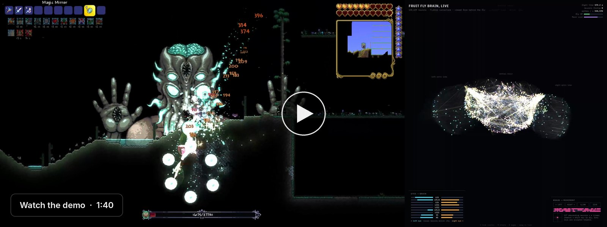
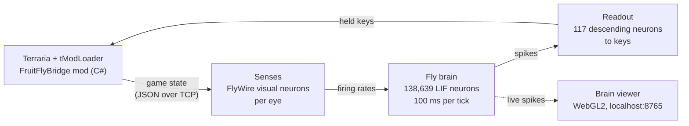
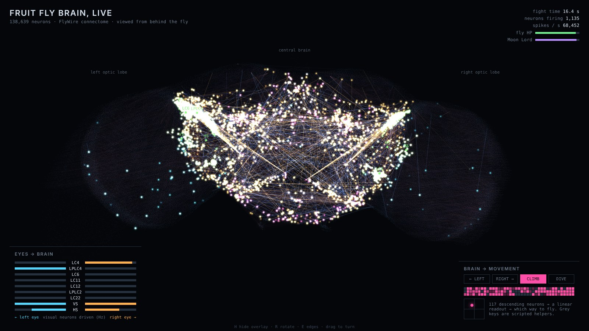

# Fruit Fly Plays Terraria

A simulated fruit-fly brain, wired exactly like the real insect's connectome, fights Terraria's final boss on Master mode and can win.

<p>
  <a href="https://www.python.org/"><picture><source media="(prefers-color-scheme: dark)" srcset="https://shieldcn.dev/badge/Python-3.12%2B-3776AB.svg?logo=python&amp;variant=outline&amp;mode=dark"></picture></a>
  <a href="https://github.com/tModLoader/tModLoader"><picture><source media="(prefers-color-scheme: dark)" srcset="https://shieldcn.dev/badge/tModLoader-v2026.07.3-2F9E44.svg?logo=false&amp;variant=outline&amp;mode=dark"></picture></a>
  <a href="https://codex.flywire.ai/"><picture><source media="(prefers-color-scheme: dark)" srcset="https://shieldcn.dev/badge/connectome-FlyWire_v783-8B5CF6.svg?logo=false&amp;variant=outline&amp;mode=dark"></picture></a>
  <a href="LICENSE"><picture><source media="(prefers-color-scheme: dark)" srcset="https://shieldcn.dev/github/license/adriandbf/fruitfly-terraria.svg?variant=outline&amp;mode=dark"></picture></a>
  <a href="https://github.com/adriandbf/fruitfly-terraria/stargazers"><picture><source media="(prefers-color-scheme: dark)" srcset="https://shieldcn.dev/github/stars/adriandbf/fruitfly-terraria.svg?variant=outline&amp;mode=dark"></picture></a>
</p>

**[Demo](#demo)** · **[How it works](#how-it-works)** · **[Setup](#setup)** · **[Training details](training/moonlord/README.md)**

## Demo

<!-- DEMO VIDEO URL MISSING: once the video is hosted, wrap the image below in <a href="VIDEO_URL">…</a>. -->


*A Master-mode Moon Lord fight: the game on the left, the fly's brain firing live on the right.*

## Overview

The brain is the whole-brain model of *Drosophila melanogaster* from Shiu et al. (Nature, 2024): **138,639 leaky integrate-and-fire neurons and 15 million synapses**, wired exactly as in the FlyWire connectome (v783). What the fly sees in the game is delivered to real fly visual neurons, and its moves are read from real descending neurons, the cells that carry commands from a fly's brain to its body.

The wiring is never changed. Only the interface around it is designed and trained: how the game becomes sensory input, and how descending-neuron firing becomes keys. That raises the question the project is built to answer: **does the real wiring do useful work, or would any network of the same size do?** A shuffled-connectome control, trained the same way, answers it (see [Results](#results)).

**What makes it work:**

- **Real-time brain simulation.** A numba reimplementation of the Brian 2 model runs 100 ms of brain time in about 20 ms, fast enough to play live, and is validated against Brian 2.
- **Biologically grounded senses.** Each sensory channel is an identified FlyWire visual population per eye (looming, small-object and self-motion detectors), coding *time to contact* as real looming neurons do.
- **Imitation learning on a fixed brain.** A linear readout from 117 identified descending neurons is learned by imitating a teacher, then refined on the fly's own fights with DAgger.
- **An offline fight fitted to the real game.** A Python stand-in for the mod, calibrated against live fight logs, lets training run thousands of fights without the game.
- **Honest credit.** Every key press is logged with who made it (brain or a scripted helper), so results separate what the brain did from what the harness did.

## Results

Moon Lord fights in the live game, as a summoner in a purpose-built arena with a Nurse house underneath. 10 fights per row:

| Fly | Difficulty | Wins | Hits taken / min |
|---|---|---|---|
| Expert-trained fly | Expert, no Nurse | 0 / 10 | ~14 |
| Expert-trained fly (`scene3_np_none`) | Expert + Nurse | **9 / 10** | 14.1 |
| Expert-trained fly | **Master** + Nurse | 1 / 10 | 13.9 |
| Trained to dodge the homing eyes | Master + Nurse | 3 / 10 | 11.1 |
| + deathray-beam sense (`scene3_master_ray`, the default) | Master + Nurse | **3 / 10** | **9.8** |
| All attacks weighted (`scene3_master_all`) | Master + Nurse | 2 / 10 | 12.6 |

The same build standing still lost all 5 of its Master fights, taking about 29 hits a minute.

**Does the wiring matter?** The control brain is the same model with every synapse's target shuffled (same neurons, same senses, same readout, trained with the same pipeline). In offline Master fights its descending neurons barely respond (2 of 117 fire), the readout explains 13% of the teacher's moves instead of 92%, and it takes 2,294 damage a minute against 1,203 for the real connectome. On Expert, the shuffled brain barely moved and lost like a character standing still.

## How it works



- **Bridge** (`bridge/`). A client-side tModLoader mod that exposes player, NPC and projectile state and accepts held keys over a local TCP socket (127.0.0.1 only).
- **Senses** (`training/moonlord/scene3.py`). Every channel is a real FlyWire visual population, one per eye: LC4 (big things level with the fly), LPLC4 (approaching from above), LC6 (big things below), LC11 and LC12 (small objects, i.e. projectiles), LPLC2 (about to hit), LC22 (the sweeping deathray), and VS / HS (the fly's own motion).
- **Brain** (`brain/fast_sim.py`). The numba engine; `brain/np_sim.py` is a pure-NumPy version for offline training, and `brain/brain_backend.py` adds the shuffled and ablated control brains.
- **Readout** (`training/moonlord/scene_fly3.py`). A linear map from the 117 descending neurons to "sideways" and "climb / dive". Training is described in [training/moonlord/README.md](training/moonlord/README.md).
- **What is scripted, and credited as such in every log:** the whip swing (minions follow its tag and do the damage, as for a human summoner), healing potions, an arena leash, and trips to the Nurse. The brain moves the character on 84% of fight ticks and flies itself back out of the Nurse room.

## Tech stack

| Area | Technologies |
|---|---|
| Brain simulation | Python, NumPy, numba, pandas + pyarrow (connectome tables), Brian 2 (reference model) |
| Game integration | C#, tModLoader mod, JSON over local TCP |
| Training | CMA-ES (`training/moonlord/cmaes.py`), imitation learning with DAgger, an offline fight fitted to live logs |
| Visualization | Standard-library HTTP server with Server-Sent Events, WebGL2 viewer with no external libraries |
| Tooling | Bash and PowerShell setup scripts, plain-Python offline test suites |

## Setup

**Prerequisites:** Terraria with tModLoader v2026.07.3.0 (Terraria 1.4.4 content), Python 3.12 or newer, Git. Developed on macOS; [docs/PC_SETUP.md](docs/PC_SETUP.md) covers Windows. No API keys, accounts or environment variables are needed.

1. **Python dependencies**
   ```bash
   git clone https://github.com/adriandbf/fruitfly-terraria.git
   cd fruitfly-terraria
   python3 -m venv .venv && source .venv/bin/activate
   pip install -r requirements.txt
   ```
2. **Brain model and data** (not in this repo):
   ```bash
   git clone --depth 1 https://github.com/philshiu/Drosophila_brain_model brain/Drosophila_brain_model
   ```
   Then place the FlyWire neuron annotation table (`Supplemental_file1_neuron_annotations.tsv` from [flyconnectome/flywire_annotations](https://github.com/flyconnectome/flywire_annotations)) at `brain/data/flywire_annotations.tsv.gz`, gzipped. It supplies neuron identities and the viewer's cell positions. For offline training, also run `python brain/export_connectome_npz.py`.
3. **The mod.** Link `bridge/mod/FruitFlyBridge` into tModLoader's `ModSources`, then **Build + Reload** in game (details in [bridge/README.md](bridge/README.md)).
4. **World and character**, once, in a large Master world:
   ```bash
   python training/moonlord/harness.py --setup-character        # loadout.json gear, max stats
   python training/moonlord/harness.py --build-arena --here     # stand on open surface ground first
   python training/moonlord/harness.py --build-nurse-house      # the hand-built house, under the arena
   ```

## Usage

**One demo fight**, with the game running in the arena world:

```bash
python demo.py
```

It builds the brain, opens the brain viewer at **http://localhost:8765**, puts the character in the arena and summons the minions. It then waits for Enter, so you can start recording, and runs one Moon Lord fight with the best fly. When the fight ends it stops; nothing is reset. The brain's activity is saved to `logs/moonlord/<run>_brain.jsonl.gz`, and `python viz/replay.py <file>` plays it back later.

Viewer keys: **H** hides the overlay, **R** toggles rotation, **E** toggles the wiring, drag to turn. For OBS, add it as a Browser Source at `http://localhost:8765/?bg=transparent` (`&hud=0` for the brain alone). Recording on a second machine is covered in [docs/PC_SETUP.md](docs/PC_SETUP.md).


*The brain viewer (`viz/`): all 138,639 neurons at their cell-body positions, glowing as they spike, with the fly's eyes on the left and its moves on the right.*

**Batches of fights and analysis:**

```bash
python training/moonlord/harness.py --policy fly --nurse --whip-strategy balanced --episodes 10 --keep-focus
python training/moonlord/hit_sources.py "logs/moonlord/<run>_fly_fight_ep*.jsonl"
python training/moonlord/report.py
```

Other policies: `idle`, `random`, `scripted`, `human`. `--fake` runs the offline fight instead of the game (`--fake --fake-master --engine np` works without numba).

## Testing

The offline suites need neither the game nor the connectome:

```bash
python training/moonlord/test_harness.py && python training/moonlord/test_training.py
```

They cover the offline fight, the harness's scripted helpers and Nurse protocol, the senses, CMA-ES, and the viewer's frame encoding. The mod itself is checked by building it in tModLoader.

## Repository layout

| Path | Contents |
|---|---|
| `demo.py` | One recorded demo fight |
| `brain/` | Brain simulators (`fast_sim.py`, `np_sim.py`), engines and control brains (`brain_backend.py`), named neurons (`neurons.py`, `scene_neurons.json`), the vertical-readout sweep |
| `bridge/` | The tModLoader mod and its Python client |
| `training/moonlord/` | Fight harness, senses, the fly, training, the offline fight, analysis |
| `viz/` | The brain viewer, its live feed and replay |
| `docs/` | PC setup guide, images |

## Limitations

- The brain moves the character, but the whip, potions, arena leash and Nurse trips are scripted, and every log credits them separately.
- On Master mode the best fly wins 3 of 10 live fights; the project's current focus is reducing the hits it takes.
- Only the readout is learned. Training happens mostly in the offline fight, which approximates the game from live logs rather than reproducing it.
- The brain and the game share one machine; the brain needs about 20 ms of CPU per 100 ms tick.

## History

1. **Speed.** Brian 2 was too slow for live play, so `fast_sim.py` reimplements the model; against Brian 2 it agrees on which neurons are active (98% overlap) and on motor-neuron spike counts.
2. **Bridge.** A client-side mod exposing game state and keys over local TCP.
3. **First goal: approach and flee.** Sugar-receptor neurons drove walking toward a player; LC4 looming neurons drove the Giant Fiber escape. Three null brains (random mapping, shuffled connectome, ablation) all scored zero.
4. **Moon Lord.** Arena, loadout and harness in the mod; an offline fight fitted to live logs; senses that grew from left/right looming to direction- and time-to-contact-resolved visual populations; the Nurse; Expert wins; then Master, cutting hits taken one attack at a time.

The code of the earlier stages is in the git history at tag [`archive/pre-cleanup`](https://github.com/adriandbf/fruitfly-terraria/tree/archive/pre-cleanup).

## License and credits

This project is released under the [MIT License](LICENSE).

- **Brain model:** Shiu, P. K. et al., *A Drosophila computational brain model reveals sensorimotor processing*, Nature (2024), [philshiu/Drosophila_brain_model](https://github.com/philshiu/Drosophila_brain_model) (MIT).
- **Connectome and annotations:** FlyWire (Dorkenwald et al.; Schlegel et al., Nature 2024). The connectome data is downloaded separately and is not redistributed here.
- **Game:** Terraria by Re-Logic; tModLoader by the tModLoader team.
